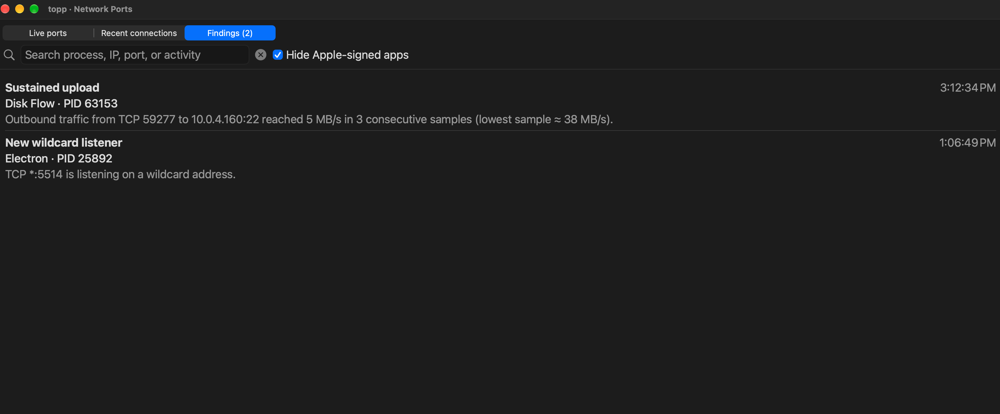

<h1 align="center">
  
</h1>

<p align="center">
  <strong>See which processes on your Mac are talking to which peers, how much traffic they send, and which changes deserve a closer look.</strong>
</p>

<p align="center">
  <a href="#quick-install">Install</a> ·
  <a href="#monitor-local-ports">Window</a> ·
  <a href="#investigate-network-activity">Findings</a> ·
  <a href="#monitor-from-the-menu-bar">Menu bar</a> ·
  <a href="#how-it-works">How it works</a> ·
  <a href="#build-from-source">Build</a>
</p>

## Highlights

- **Per-port, per-process traffic.** Live inbound and outbound rates for every local TCP and UDP port, with the process that owns it.
- **Menu bar mode.** See download and upload speeds side by side, next to the clock.
- **Process details.** Executable path, user, parent PID, start time, and application info are one click away.
- **Searchable session history.** Look up a peer after its socket disappears and review findings with the process, timestamp, and evidence.
- **Single file, no dependencies.** One universal executable for Apple Silicon and Intel.
- **Least privilege.** Only the traffic collector, built on Apple's `nettop`, runs with administrator privileges. The interface runs as your user.

## Quick install

**From Applications.** Build the menu bar app with Apple's Command Line Tools, then drag the resulting app into Applications:

```sh
sh tools/build-app.sh
open -R build/topp.app
```

Double-click **topp** in Applications and approve the macOS administrator prompt. The traffic indicator appears beside the clock. Right-click it and choose **Open Window** to inspect activity. Closing that window keeps monitoring active. Choose **Quit topp** from the same menu to stop.

**From Terminal.** Compile the standalone command for your Mac:

```sh
git clone https://github.com/4rji/topp.git
cd topp
swiftc -O static/topp.swift -o topp
./topp
```

Launch it as your regular user. When prompted in Terminal, enter your administrator password. Closing the window quits the monitor.

To install the command on your PATH, run these commands from the cloned directory:

```sh
sudo install -d /usr/local/bin
sudo install -m 755 ./topp /usr/local/bin/topp
```

## Usage

| Command | What it does |
| --- | --- |
| `topp` | Open the window and show the menu bar indicator. Closing the window quits topp. |
| `topp -d` | Monitor from the menu bar and return your Terminal prompt. |
| `topp --log-path` | Print the location of your persistent event log. |
| `topp --help` | Show help. |

## Monitor local ports


Each row identifies a local port, protocol, and process ID. The **Inbound** and **Outbound** columns show rates calculated from successive samples of the macOS `nettop` byte counters.

- **Sort.** Click **Port**, **Process**, or **State**. Click again to reverse the order. Sorted by **Port**, the list stays in port order and new rows appear in place. Sorted by **Process** or **State**, rows keep their order as traffic changes and new rows appear at the bottom. Changed values are highlighted.
- **Zoom.** Press **⌘+** or **⌘−** to change the text size, or **⌘0** to restore it. The window widens when needed to keep every column visible, and topp remembers the size.
- **Inspect.** Click **ⓘ** beside a process to see its executable path, user, parent PID, start time, and application details when available.
- **Act on a row.** Right-click or Control-click a **Live ports** or **Recent connections** row to reveal its executable in Finder, copy its path or PID, or copy endpoint addresses. The menu names the process and PID under the pointer. A live port also offers **Hide** and **Search Connections by Process Name**.
- **Terminate a process.** Choose **Terminate Process…** and confirm the displayed name and PID. The action sends `SIGTERM` to that process, which can affect all of its connections. It is available for a running process owned by your user when topp can verify its identity. A process can handle or ignore the request.
- **Filter.** Search by address, port, process name, PID, state, or executable path. Combine terms such as `Safari 443` to narrow the live table. Hover over a remote peer to see its full address.
- **Hide Apple-signed apps.** Select this checkbox to hide processes whose executable signature macOS verifies as Apple's. It also filters recent connections, findings, and menu bar traffic. Processes with an unknown signer stay visible. The setting is remembered across launches. Detection and the disk log still cover every observed process.
- **Hide.** Select rows and click **Hide Selected Ports** to hide those port and protocol combinations across processes. The **Hidden** menu restores them. Hidden ports stay hidden across launches.

## Investigate network activity

Open **Recent connections** to see the last 300 observed combinations of process, protocol, local endpoint, and remote endpoint. Search for a process or paste an IP address. Right-click an endpoint to copy its address and port. **Last seen** shows the most recent observation, including for sockets that have since closed. Hover over the time to see when topp first observed that entry.

Open **Findings** to review the last 200 signals from this session. Each one includes the process, PID, time, and the observation that triggered it.



In the **Sustained upload** finding above, Disk Flow (PID 63153) sent traffic from local TCP port 59277 to `10.0.4.160:22`. All three consecutive samples exceeded the 5 MB/s threshold. Even the lowest measured about 38 MB/s. The **New wildcard listener** finding shows that Electron (PID 25892) started listening on `*:5514`.

While you watch **Live ports** or **Recent connections**, an amber banner above the table counts new findings and shows the latest signal and process. Click it to open **Findings**. Opening the banner clears the search for review and restores your previous search when you leave, provided you have not entered a new one. The banner counts findings even during a port search and respects **Hide Apple-signed apps**. Reviewing the list in the active window clears the count for matching findings. The events remain in the history and log.

Right-click a finding to reveal its recorded executable in Finder, copy its path or PID, copy the finding with its timestamp and evidence, or search recent connections for the process name. **Terminate Process…** asks for confirmation when the original process is still running under your account and topp can verify its identity.

| Finding | What topp observed |
| --- | --- |
| New wildcard listener | After the initial sample, topp observed a new TCP listener bound to a wildcard address. Check whether you expected that process to accept connections. Firewall rules still determine reachability. |
| TCP attempts to multiple ports | The same process was observed in the SYN-sent state on 8 distinct TCP ports at one non-loopback address within 30 seconds. The finding includes the ports. |
| Sustained upload | A process sent at least 5 MB/s in each of 3 consecutive rate samples on one local TCP port, with a single established remote endpoint outside loopback. A backup or sync can trigger this signal. |

Both views show the current session. Earlier events are available in the log files. Hiding a port in the live table still allows its activity to appear in the history and findings. All addresses and counters come from the local sampler. Sampling can miss short-lived sockets. A single connection can carry many requests, and the monitor has no visibility into URLs, request bodies, or HTTPS contents.

### Persistent logs

Both launch modes automatically append events to `~/Library/Logs/topp/network.jsonl`, starting with the first sample. Click **Show logs** in the window to reveal the file in Finder, or follow new records in Terminal:

```sh
tail -F "$(./topp --log-path)"
```

Each line is a JSON object with a UTC timestamp and a session ID. Connection events include the process, PID, protocol, local endpoint, remote endpoint, and observed state. They record when a peer first appears, changes state, or disappears from a subsequent sample. The disappearance event includes the last time topp saw the peer. Findings include their title and evidence. Session boundaries distinguish a monitor shutdown from an observed connection ending. If writing fails, the window shows the error and topp attempts to record the gap when writing resumes.

The app writes as your login user. The log directory has mode `0700` and files have mode `0600`. At 10 MiB the active file rotates to `network.1.jsonl`. Up to five archives are retained, with `network.5.jsonl` the oldest. Logs survive a restart. Run `./topp -d` to keep logging when you close the window. Logging stops when you quit topp or log out.

## Monitor from the menu bar

Both `topp` and `topp -d` show download and upload speeds across visible ports in two fixed-width columns. **↓120 ↑11** means 120 KB/s received and 11 KB/s sent (1 KB = 1,000 bytes). The arrows stay in place as the numbers change. Each direction shows **0** when measured and idle, or **—** when its rate is unavailable.

Click the speeds to collapse them into an icon. Click again to bring the speeds back. topp remembers your choice across launches. In either mode, a bell beside the clock counts new findings. Open **Review findings** or choose **Mark Findings as Reviewed** from the right-click menu to clear the alert. Reviewed findings stay in the session history. Hover for the units and the latest pending finding. The menu also shows **Open Window** and up to five active processes ranked by traffic. Launch with `topp -d` to keep the indicator running when the window closes.


## How it works

The app uses macOS authorization and the command-line version uses `sudo` to start the same collector. It runs `/usr/bin/nettop` with a one-second pause between samples and streams its byte counters back to the unprivileged interface. A flow needs two consecutive observations with valid counters to contribute a measured rate. Only fixed system commands run as root, and the collector stops when topp quits, because its output pipe closes.

## Build from source

With Apple's Command Line Tools installed, compile the Swift source for your current Mac. This writes a separate executable under `build/`:

```sh
mkdir -p build
swiftc -O static/topp.swift -o build/topp
./build/topp --help
```

The menu bar app build targets Apple Silicon (macOS 12 or later) and Intel (macOS 14 or later). The standalone build above targets the current Mac.

Run `./tests/run.sh` to check the parser, traffic rates, findings, and connection history against sample data on macOS.

### Regenerate the banner

The animated banner is plain SVG with CSS animations, generated by [`tools/packet-flow.swift`](tools/packet-flow.swift). Each cable is a port: packets travel out from the Mac and back in, busier ports carry more packets, and idle ports stay dark. The animation pauses for viewers who prefer reduced motion.

```sh
swift tools/packet-flow.swift --output assets/packet-flow.svg
```

Drive it with real rates by passing one connection per line as `<label> <rx bytes/s> <tx bytes/s>`:

```sh
printf 'TCP 443 1.8M 210K\nTCP 22 40K 120K\nUDP 5353 0 0\n' |
  swift tools/packet-flow.swift --traffic - --output assets/packet-flow.svg
```

Other options set color, speed, direction, packet size, density, and glow. Run `swift tools/packet-flow.swift --help` for the full list.
