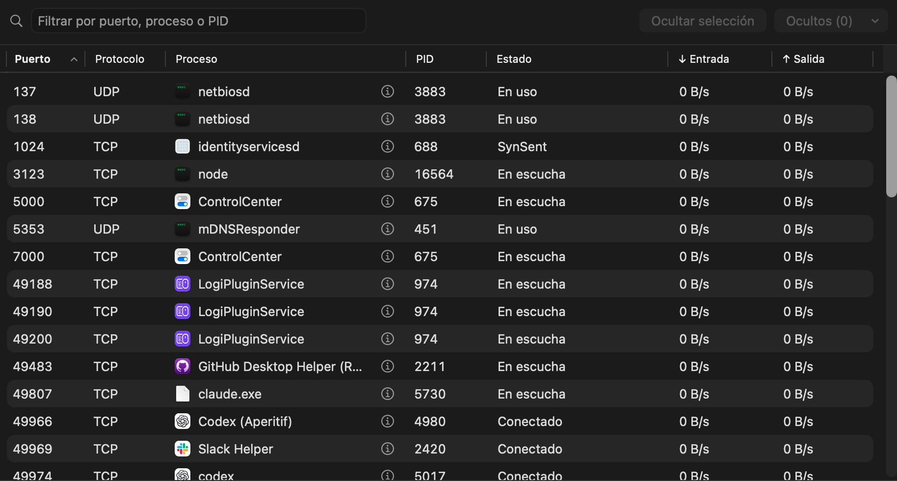

# topp

A native macOS network monitor that shows which processes own your local ports and how much data each port sends and receives.

## Quick install

The repository includes a ready-to-run executable for Apple Silicon (macOS 12 or later) and Intel (macOS 14 or later).

```sh
git clone https://github.com/4rji/topp.git
cd topp
./topp
```

Launch it as your regular user. When prompted in Terminal, enter your administrator password. Only the traffic collector runs with `sudo`. Closing the window quits the monitor.

To keep it running beside the clock and get your Terminal prompt back, use:

```sh
./topp -d
```

To install the command on your PATH, run these commands from the cloned directory:

```sh
sudo install -d /usr/local/bin
sudo install -m 755 ./topp /usr/local/bin/topp
```

You can then run `topp`, `topp -d`, or `topp --help` from any directory.

## Monitor local ports



Each row identifies a local port, protocol, and process ID. The **Inbound** and **Outbound** columns show rates calculated from successive samples of the macOS `nettop` byte counters.

- Click **Port**, **Process**, or **State** to sort. Click again to reverse the order. As traffic changes, rows keep their order and changed values are highlighted. New rows appear at the bottom.
- Click **ⓘ** beside a process to see its executable path, user, parent PID, start time, and application details when available.
- Filter by port, process name, or PID. Select rows and click **Hide Selected Ports** to hide those port and protocol combinations across processes. The **Hidden** menu restores them. Hidden ports stay hidden across launches.

## Watch the busiest port


In menu bar mode, topp shows the busiest visible port and its combined inbound and outbound rate. It adds traffic across processes sharing the same local port and protocol. A dash means there is no measured traffic to display.

Hover to see inbound and outbound rates separately. Click to open the full window, or right-click for a per-process traffic summary and **Quit topp**. Closing the window in this mode leaves the indicator running.

## Build from source

With Apple's Command Line Tools installed, compile the Swift source for your current Mac. This writes a separate executable under `build/`:

```sh
mkdir -p build
swiftc -O static/topp.swift -o build/topp
./build/topp --help
```

For deployment, copy the universal `topp` executable from the repository root to another supported Mac. The source and screenshots are only needed for development and documentation.
